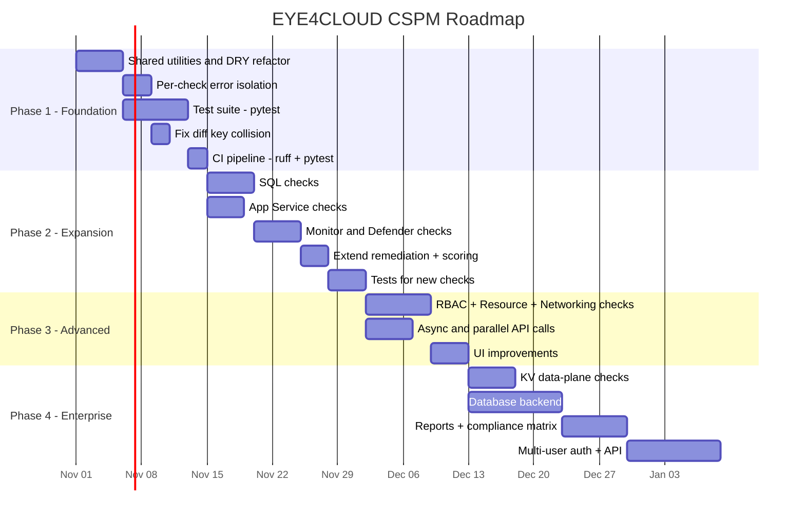

# EYE4CLOUD — CSPM Evolution Analysis

> **Date:** 2026-10-25
> **Scope:** Read-only analysis of the current codebase; no code changes.
> **Goal:** Plan how to evolve EYE4CLOUD from a lightweight Azure misconfiguration
> scanner into a comprehensive Azure-focused CSPM tool.

---

## 1. Architecture Summary

### High-level data flow

```
checks/*.py  -->  core/scanner.py  -->  core/scoring.py + core/diff.py  -->  app.py (Streamlit UI)
     |                |                                                       ^
 Azure SDK        results/scan_<ts>.json                                    pandas
```

### Module breakdown

| Layer | Module | Responsibility |
|-------|--------|----------------|
| **Auth** | `core/auth.py` | Builds `ClientSecretCredential` or `AzureCliCredential`; creates a `dataclass AzureClients` holding `StorageManagementClient`, `NetworkManagementClient`, `KeyVaultManagementClient`, `ComputeManagementClient` per subscription |
| **Checks** | `checks/storage_checks.py` | 3 checks (public blob, HTTPS-only, TLS >= 1.2) |
| | `checks/nsg_checks.py` | 1 check (SSH/RDP from 0.0.0.0/0) |
| | `checks/keyvault_checks.py` | 2 checks (soft-delete, purge-protection) — uses extra `vaults.get()` per vault because `list_by_subscription()` returns partial properties |
| | `checks/vm_checks.py` | 2 checks (disk CMK encryption, public IP on VM) |
| | `checks/dependency_checks.py` | OSV.dev CVE lookup on `requirements.lock.txt` (not Azure, SCA) |
| **Orchestrator** | `core/scanner.py` | Loops subscriptions, calls all `run_all_*_checks()`, appends `subscription_id` to each finding, saves JSON, sends webhook notification |
| **Scoring** | `core/scoring.py` | Weighted-deduction model: 100 - (High x 15 + Medium x 7 + Low x 3), per-category and overall; respects accepted-risk exclusions |
| **Diff / Trend** | `core/diff.py` | Compares last two scan JSONs via `(category, resource, check)` key; produces new/resolved lists + score delta; `score_history()` for line chart |
| **History** | `core/history.py` | File-system CRUD on `results/scan_*.json` |
| **Accepted risks** | `core/exceptions.py` | JSON-backed accept/revoke/list with `(category, resource, check)` key |
| **Remediation** | `core/remediation.py` | Static dict mapping `check_id` to advice text + templated `az cli` command |
| **Notifications** | `core/notifications.py` | Teams MessageCard / Slack webhook; failure is swallowed silently |
| **Dashboard auth** | `core/dashboard_auth.py` | Optional bcrypt password gate via `streamlit-authenticator`; single user, cookie-based |
| **UI** | `app.py` | 5-tab Streamlit dashboard: Overview, Findings, History, Dependencies, Accepted Risks |
| **Scripts** | `scripts/scheduled_scan.py` | Headless scan wrapper for cron/CI |
| | `scripts/hash_password.py` | bcrypt hash generator for dashboard password |

### Finding format (contract)

Every check function returns a `list[dict]`, where each dict has **exactly** these keys:

```json
{
  "category":       "Storage Account | Network Security Group | Key Vault | Virtual Machine | Dependency",
  "resource":       "<resource name or package==version>",
  "resource_group": "<RG name or N/A>",
  "check":          "<unique check ID string>",
  "issue":          "<human-readable description>",
  "severity":       "High | Medium | Low",
  "compliance":     "CIS Azure X.Y | N/A (...)"
}
```

`scanner.py` adds `"subscription_id"` after collection. This format is the system-wide
contract — diff, scoring, remediation, exceptions, and the UI all depend on it.

---

## 2. Existing Checks Inventory

| # | Check ID | Module | Azure Service | What it verifies | Severity | CIS v2.1.0 |
|---|----------|--------|---------------|------------------|----------|------------|
| 1 | `public_blob_access` | `storage_checks.py` | Storage Account | `allow_blob_public_access` is not True/None | High | 3.7 |
| 2 | `secure_transfer` | `storage_checks.py` | Storage Account | `enable_https_traffic_only` is True | Medium | 3.1 |
| 3 | `minimum_tls_version` | `storage_checks.py` | Storage Account | `minimum_tls_version` >= TLS1_2 | Medium | 3.15 |
| 4 | `open_management_port` | `nsg_checks.py` | Network Security Group | No inbound Allow rule from `*/0.0.0.0/0/Internet/Any` to port 22/3389 | High | 6.1, 6.2 |
| 5 | `soft_delete` | `keyvault_checks.py` | Key Vault | `enable_soft_delete` is True | High | 8.5 |
| 6 | `purge_protection` | `keyvault_checks.py` | Key Vault | `enable_purge_protection` is True | High | 8.5 |
| 7 | `disk_cmk_encryption` | `vm_checks.py` | Virtual Machine | All managed disks have a Disk Encryption Set (CMK) attached | Medium | 7.2 |
| 8 | `vm_public_ip` | `vm_checks.py` | Virtual Machine | No NIC has a public IP address | Medium | N/A |
| 9 | `known_vulnerability` | `dependency_checks.py` | Dependency (SCA) | No known CVE/GHSA in `requirements.lock.txt` via OSV.dev | Varies | N/A |

**Services covered:** Storage Account (3), NSG (1), Key Vault (2), VM (2), Dependency/SCA (1).

**Services NOT covered:** Azure SQL, App Service, Activity Log / Monitor, Defender for Cloud, Entra ID / RBAC, Networking (beyond NSG rules), Storage advanced (network rules, soft delete, private endpoints).

---

## 3. Proposed 20 Missing Checks

Grouped by service. For each: what it verifies, severity, SDK package, SDK method, and
implementation effort (S = small / straightforward, M = moderate, L = large / complex).

> **IMPORTANT:** Items marked **UNVERIFIED** need manual confirmation of the exact CIS
> control number or SDK method signature before implementation.

### 3.1 Storage Account (2 new)

| # | Check | Verifies | Sev. | CIS | SDK Package | SDK Method | Effort |
|---|-------|----------|------|-----|-------------|------------|--------|
| 1 | **Storage default network rule is Deny** | `network_rule_set.default_action == "Deny"` — prevents unrestricted network access to storage data | High | UNVERIFIED (likely 3.8 or 3.9) | `azure-mgmt-storage` | `storage_accounts.list()` then inspect `network_rule_set.default_action` | S |
| 2 | **Blob soft-delete enabled** | `blob_service_properties.delete_retention_policy.enabled` is True — protects against accidental/malicious blob deletion | Medium | UNVERIFIED | `azure-mgmt-storage` | `blob_services.get_service_properties(rg, account, "default")` then `delete_retention_policy.enabled` | S |

### 3.2 Key Vault (2 new)

| # | Check | Verifies | Sev. | CIS | SDK Package | SDK Method | Effort |
|---|-------|----------|------|-----|-------------|------------|--------|
| 3 | **Key Vault keys have expiration date** | Every key in the vault has `attributes.expires` set — prevents indefinite key validity | Medium | UNVERIFIED (likely 8.1) | `azure-keyvault-keys` | `KeyClient.list_properties_of_keys()` then check `expires_on` | M |
| 4 | **Key Vault secrets have expiration date** | Every secret has `attributes.expires` set | Medium | UNVERIFIED (likely 8.2) | `azure-keyvault-secrets` | `SecretClient.list_properties_of_secrets()` then check `expires_on` | M |

> **NOTE:** Checks 3-4 require **data-plane** access (`azure-keyvault-keys` /
> `azure-keyvault-secrets`), which needs a Key Vault access policy or RBAC data-plane
> role — **not** just the subscription-level Reader role currently used. This is a
> significant permissions change.

### 3.3 Network Security Group / Networking (2 new)

| # | Check | Verifies | Sev. | CIS | SDK Package | SDK Method | Effort |
|---|-------|----------|------|-----|-------------|------------|--------|
| 5 | **NSG allows unrestricted UDP access** | No inbound Allow from `0.0.0.0/0` to any UDP port (DNS amplification, etc.) | Medium | UNVERIFIED (likely 6.3 or 6.4) | `azure-mgmt-network` | Same iteration as existing `nsg_checks.py`, extend `_port_matches_risky` to cover UDP protocol check | S |
| 6 | **Network Watcher is enabled per region** | A Network Watcher resource exists for every region in which the subscription has VNets | Medium | UNVERIFIED (likely 6.5) | `azure-mgmt-network` | `network_watchers.list_all()` cross-ref with regions from `virtual_networks.list_all()` | M |

### 3.4 Virtual Machine (1 new)

| # | Check | Verifies | Sev. | CIS | SDK Package | SDK Method | Effort |
|---|-------|----------|------|-----|-------------|------------|--------|
| 7 | **VM extensions: Guest Configuration agent installed** | The `AzurePolicyforLinux` / `AzurePolicyforWindows` extension is present — needed for in-guest policy evaluation | Low | UNVERIFIED | `azure-mgmt-compute` | `virtual_machine_extensions.list(rg, vm_name)` then search for extension type | M |

### 3.5 Azure SQL (3 new)

| # | Check | Verifies | Sev. | CIS | SDK Package | SDK Method | Effort |
|---|-------|----------|------|-----|-------------|------------|--------|
| 8 | **SQL Server auditing enabled** | `server_blob_auditing_policies.get()` returns `state == "Enabled"` | High | UNVERIFIED (likely 4.1.1) | `azure-mgmt-sql` | `sql_client.server_blob_auditing_policies.get(rg, server)` | M |
| 9 | **SQL Server firewall: no Allow all IPs** | No firewall rule with `start_ip == "0.0.0.0"` and `end_ip == "255.255.255.255"` (or `0.0.0.0`) | High | UNVERIFIED (likely 4.1.2) | `azure-mgmt-sql` | `sql_client.firewall_rules.list_by_server(rg, server)` | S |
| 10 | **SQL Database TDE enabled** | Transparent Data Encryption state is `Enabled` on every database | High | UNVERIFIED (likely 4.1.3) | `azure-mgmt-sql` | `sql_client.transparent_data_encryptions.get(rg, server, db, "current")` | M |

### 3.6 App Service (3 new)

| # | Check | Verifies | Sev. | CIS | SDK Package | SDK Method | Effort |
|---|-------|----------|------|-----|-------------|------------|--------|
| 11 | **App Service HTTPS Only** | `web_app.https_only == True` — redirects HTTP to HTTPS | Medium | UNVERIFIED (likely 9.2) | `azure-mgmt-web` | `web_client.web_apps.list()` then `https_only` | S |
| 12 | **App Service minimum TLS >= 1.2** | `site_config.min_tls_version` is `"1.2"` or higher | Medium | UNVERIFIED (likely 9.3) | `azure-mgmt-web` | `web_client.web_apps.list()` then `site_config.min_tls_version` | S |
| 13 | **App Service client certificates (mutual TLS)** | `client_cert_enabled == True` for apps requiring strong auth | Low | UNVERIFIED (likely 9.4) | `azure-mgmt-web` | `web_client.web_apps.list()` then `client_cert_enabled` | S |

### 3.7 Activity Log / Monitor (2 new)

| # | Check | Verifies | Sev. | CIS | SDK Package | SDK Method | Effort |
|---|-------|----------|------|-----|-------------|------------|--------|
| 14 | **Activity Log diagnostic setting exists** | At least one subscription-level diagnostic setting is configured to export the Activity Log (to Log Analytics, Storage, or Event Hub) | High | UNVERIFIED (likely 5.1.1) | `azure-mgmt-monitor` | `monitor_client.subscription_diagnostic_settings.list()` — check that at least one setting exists with enabled log categories | M |
| 15 | **Key Vault diagnostic logging enabled** | Each Key Vault has at least one resource-level diagnostic setting with `AuditEvent` log category enabled | Medium | UNVERIFIED (likely 5.1.5) | `azure-mgmt-monitor` | `monitor_client.diagnostic_settings.list(resource_uri=vault.id)` then check for enabled `AuditEvent` category | M |

### 3.8 Defender for Cloud (2 new)

| # | Check | Verifies | Sev. | CIS | SDK Package | SDK Method | Effort |
|---|-------|----------|------|-----|-------------|------------|--------|
| 16 | **Defender for Servers is Standard tier** | `pricings.get("VirtualMachines").pricing_tier == "Standard"` — not Free | High | UNVERIFIED (likely 2.1.1) | `azure-mgmt-security` | `security_client.pricings.get("VirtualMachines")` | S |
| 17 | **Defender for Storage is Standard tier** | `pricings.get("StorageAccounts").pricing_tier == "Standard"` | High | UNVERIFIED (likely 2.1.3) | `azure-mgmt-security` | `security_client.pricings.get("StorageAccounts")` | S |

> **NOTE:** The exact `pricings.get()` resource name strings (`"VirtualMachines"`,
> `"StorageAccounts"`) need verification against the current API version — they have
> changed across SDK versions. Mark as **UNVERIFIED**.

### 3.9 Entra ID / RBAC (2 new)

| # | Check | Verifies | Sev. | CIS | SDK Package | SDK Method | Effort |
|---|-------|----------|------|-----|-------------|------------|--------|
| 18 | **No custom Owner role assignments at subscription** | No role assignments granting full `Owner` (or `*` actions) scope at subscription level to non-service-principal identities | High | UNVERIFIED (likely 1.23) | `azure-mgmt-authorization` | `role_assignments.list_for_scope(scope="/subscriptions/{id}")` cross-referenced with `role_definitions.get()` to check for `Owner` | L |
| 19 | **No classic administrators (Co-Admin)** | `classic_administrators.list()` returns zero or only the mandatory Service Administrator — Co-Administrators are a legacy risk | Medium | UNVERIFIED (likely 1.24) | `azure-mgmt-authorization` | `auth_client.classic_administrators.list()` | S |

### 3.10 Cross-cutting (1 new)

| # | Check | Verifies | Sev. | CIS | SDK Package | SDK Method | Effort |
|---|-------|----------|------|-----|-------------|------------|--------|
| 20 | **Resource locks on critical resources** | Production resource groups have at least a `CanNotDelete` lock to prevent accidental deletion | Low | N/A | `azure-mgmt-resource` | `management_lock_client.management_locks.list_at_resource_group_level(rg)` | M |

### Summary of new SDK packages required

| Package | Checks it enables | Currently in requirements.txt? |
|---------|-------------------|--------------------------------|
| `azure-mgmt-sql` | #8, #9, #10 | No |
| `azure-mgmt-web` | #11, #12, #13 | No |
| `azure-mgmt-monitor` | #14, #15 | No |
| `azure-mgmt-security` | #16, #17 | No |
| `azure-mgmt-authorization` | #18, #19 | No |
| `azure-mgmt-resource` | #20 | No |
| `azure-keyvault-keys` | #3 | No |
| `azure-keyvault-secrets` | #4 | No |

---

## 4. Code Weaknesses and Improvement Opportunities

### 4.1 Duplicated Logic

| Issue | Where | Impact |
|-------|-------|--------|
| **`_finding()` helper duplicated in every check module** | `storage_checks.py:20`, `nsg_checks.py:33`, `keyvault_checks.py:17`, `vm_checks.py:24`, `dependency_checks.py:24` | Each defines its own `_finding()` that constructs the same dict shape. A single shared `Finding` dataclass or factory function in `core/` would eliminate this and enforce the contract centrally. |
| **`_finding_key()` duplicated** | `core/diff.py:17` and `core/exceptions.py:17` | Identical `(category, resource, check)` tuple builder defined in two places. Should be a single shared utility. |
| **`resource_group` extracted via `id.split("/")[4]`** | Every check module, multiple places | Fragile ARM ID parsing duplicated everywhere. A single `parse_resource_group(arm_id)` utility would be safer and DRYer. |
| **`RESULTS_DIR` defined in two modules** | `core/scanner.py:25` and `core/history.py:14` | Same path construction. Should be a single constant. |

### 4.2 Missing Error Handling

| Issue | Where | Risk |
|-------|-------|------|
| **Storage/NSG/KV checks have no try/except** | `storage_checks.py`, `nsg_checks.py`, `keyvault_checks.py` | If one Azure API call fails (permissions, throttling, transient error), the entire scan aborts. Only `vm_checks.py` wraps its call in `HttpResponseError`. Every check module should be independently resilient. |
| **Dependency check swallows all `RequestException`** | `dependency_checks.py:89` | A 4xx (e.g., invalid package name) and a network timeout are treated identically — both silently skipped. Worth at least logging. |
| **`accepted_risks.json` race condition** | `core/exceptions.py` | File read then modify then write is not atomic. Concurrent Streamlit sessions or a simultaneous scheduled scan could corrupt the file. |
| **`history.py:clear_history` relies on naming convention** | `core/history.py:35-38` | `clear_history()` globs `scan_*.json` which correctly skips accepted_risks, but this relies on naming convention only — no explicit safeguard. |

### 4.3 Missing Tests

- **Zero test files exist** in the entire project. No `tests/` directory, no `pytest` in requirements.
- Critical logic that should be unit-tested:
  - `scoring.py`: score calculation with various finding combinations
  - `diff.py`: new/resolved finding detection
  - `nsg_checks._port_matches_risky()`: range parsing, edge cases
  - `remediation.py.get_remediation()`: template substitution
  - `exceptions.py`: accept/revoke idempotency
- Check modules could be tested with mocked Azure SDK responses.

### 4.4 Sequential API Calls / Performance

| Issue | Impact |
|-------|--------|
| **All storage checks iterate `storage_accounts.list()` independently** | `check_public_blob_access`, `check_secure_transfer`, `check_minimum_tls_version` each call `.list()` — that is 3 full API pagination passes over the same data. Should iterate once and run all checks per account. |
| **Key Vault `vaults.get()` called per vault sequentially** | N+1 query pattern. Could use `asyncio` + `aiohttp` or at minimum `concurrent.futures` to parallelize. |
| **VM public IP check: NIC `.get()` per VM per NIC** | Another N x M sequential API pattern. Large subscriptions with many VMs will be slow. |
| **OSV.dev queries are sequential per package** | One HTTP POST per dependency, serially. Could batch or parallelize. |
| **Multi-subscription scans are fully sequential** | `scanner.py:40-41` loops subscriptions one at a time. |

### 4.5 Limitations (from README + discovered)

| Limitation | Notes |
|------------|-------|
| Only 4 Azure resource types (+ dependency SCA) | See Section 3 for expansion plan |
| Multi-subscription diff key collision | README L146-148: `(category, resource, check)` key does not include subscription_id, so identically-named resources across subscriptions collide in diff and accepted-risks |
| VM disk encryption: ADE vs SSE+CMK confusion | README L275-276: ADE-encrypted VMs falsely flagged; check does not inspect VM extensions for ADE |
| Score model is simplistic | Linear deduction; does not account for resource count, blast radius, or risk context |
| No pagination handling for large subscriptions | SDK `.list()` returns lazy iterators, but if a page fails mid-stream, the whole check fails |
| Dashboard auth is not production-grade | Single user, no RBAC, no HTTPS, plaintext cookie key |
| Results stored as flat JSON files | No database; concurrent access is unsafe; querying history is O(n) full-file reads |
| No CI/CD pipeline config for the project itself | No `pyproject.toml`, no linting config, no GitHub Actions for tests |

---

## 5. Phased Roadmap

### Phase 1 — Foundation Hardening (2-3 weeks)

> Goal: Make the existing 8 Azure checks robust, testable, and faster.

| Deliverable | Details |
|-------------|---------|
| **Shared finding utilities** | Create `core/finding.py` with `Finding` dataclass (or TypedDict), `finding_key()`, and `parse_resource_group()`. Refactor all check modules to use them. |
| **Single-pass storage iteration** | Refactor `storage_checks.py` to iterate `storage_accounts.list()` once and run all 3 checks per account. |
| **Per-check error isolation** | Wrap each `run_all_*_checks()` call in `scanner.py` with try/except so one failing service does not abort the entire scan. Log errors. Return partial results. |
| **Test suite (pytest)** | Add `tests/` with unit tests for `scoring.py`, `diff.py`, `nsg_checks._port_matches_risky()`, `remediation.py`, and `exceptions.py`. Mock Azure SDK responses for check modules. Target 80%+ coverage on `core/`. |
| **Fix diff key collision** | Add `subscription_id` to the finding key tuple: `(subscription_id, category, resource, check)`. Update `diff.py`, `exceptions.py`, and `scoring.py`. |
| **CI pipeline** | Add `pyproject.toml` with `ruff` linting + `pytest`. Add `.github/workflows/ci.yml` for lint + test on PR. |

### Phase 2 — Check Expansion: High-Value Services (3-4 weeks)

> Goal: Add the 12 most impactful missing checks covering 5 new Azure services.

| Deliverable | New Checks | New SDK Packages |
|-------------|------------|------------------|
| `checks/sql_checks.py` | #8 Auditing, #9 Firewall 0.0.0.0, #10 TDE | `azure-mgmt-sql` |
| `checks/appservice_checks.py` | #11 HTTPS-only, #12 TLS >= 1.2, #13 Client certs | `azure-mgmt-web` |
| `checks/monitor_checks.py` | #14 Activity Log diagnostic, #15 KV diagnostic logging | `azure-mgmt-monitor` |
| `checks/defender_checks.py` | #16 Defender for Servers, #17 Defender for Storage | `azure-mgmt-security` |
| **Extend `AzureClients` dataclass** | Add `sql`, `web`, `monitor`, `security` clients | — |
| **Extend `remediation.py`** | Add remediation entries for all 12 new checks | — |
| **Extend `scoring.py`** | Add new categories to `all_categories` set | — |
| **Tests for new checks** | Mocked SDK tests for each new module | — |

### Phase 3 — Advanced Checks + Performance (3-4 weeks)

> Goal: Add RBAC/governance checks, parallelize API calls, improve UX.

| Deliverable | Details |
|-------------|---------|
| `checks/rbac_checks.py` | #18 Custom Owner audit, #19 Classic admins (`azure-mgmt-authorization`) |
| `checks/resource_checks.py` | #20 Resource locks (`azure-mgmt-resource`) |
| **Networking expansion** | #5 Unrestricted UDP, #6 Network Watcher per region |
| **VM extension check** | #7 Guest Configuration agent |
| **Async / parallel API calls** | Use `concurrent.futures.ThreadPoolExecutor` (or `asyncio` if Azure SDK async clients are used) to parallelize NIC lookups, Key Vault `get()`, OSV queries, and multi-subscription scans. |
| **Progress feedback** | Add Streamlit progress bar during scan showing which check module is running. |
| **Filtering and grouping in UI** | Add severity/category/subscription filters on the Findings tab. |

### Phase 4 — Enterprise Features (4-6 weeks)

> Goal: Make EYE4CLOUD suitable for production/team use.

| Deliverable | Details |
|-------------|---------|
| **Key Vault data-plane checks** | #3 Key expiration, #4 Secret expiration. Requires additional RBAC permissions (Key Vault Reader data-plane role). Document the permission escalation clearly. |
| **SQLite/PostgreSQL backend** | Replace JSON files with a proper database for scan results and accepted risks. Enable concurrent access and efficient history queries. |
| **Export: PDF / HTML report** | Generate a branded downloadable report for stakeholders. |
| **Compliance mapping dashboard** | CIS benchmark section to pass/fail/not-evaluated matrix view. |
| **RBAC for dashboard** | Multi-user support with Entra ID (MSAL) authentication replacing the current single-password gate. |
| **Policy-as-Code** | Allow users to define custom checks via YAML config files (e.g., "this RG must have a CanNotDelete lock"). |
| **API endpoint** | Add a REST/FastAPI layer for integration with ticketing systems (Jira, ServiceNow). |
| **Alerting rules** | Configurable thresholds: "if score drops below 60, send alert" or "if new High finding appears, create ticket." |

### Roadmap visualization



---

## Appendix: Quick Reference — New Dependencies to Add

```
# Phase 2
azure-mgmt-sql>=9.0.0
azure-mgmt-web>=7.3.0
azure-mgmt-monitor>=6.0.0
azure-mgmt-security>=6.0.0

# Phase 3
azure-mgmt-authorization>=4.0.0
azure-mgmt-resource>=23.1.0

# Phase 4
azure-keyvault-keys>=4.9.0
azure-keyvault-secrets>=4.8.0

# Testing
pytest>=8.0.0
pytest-cov>=5.0.0
ruff>=0.5.0
```

> **WARNING:** The version numbers above are reasonable lower bounds as of mid-2026, but
> should be verified against PyPI at implementation time. Pin exact versions in
> `requirements.lock.txt`.
